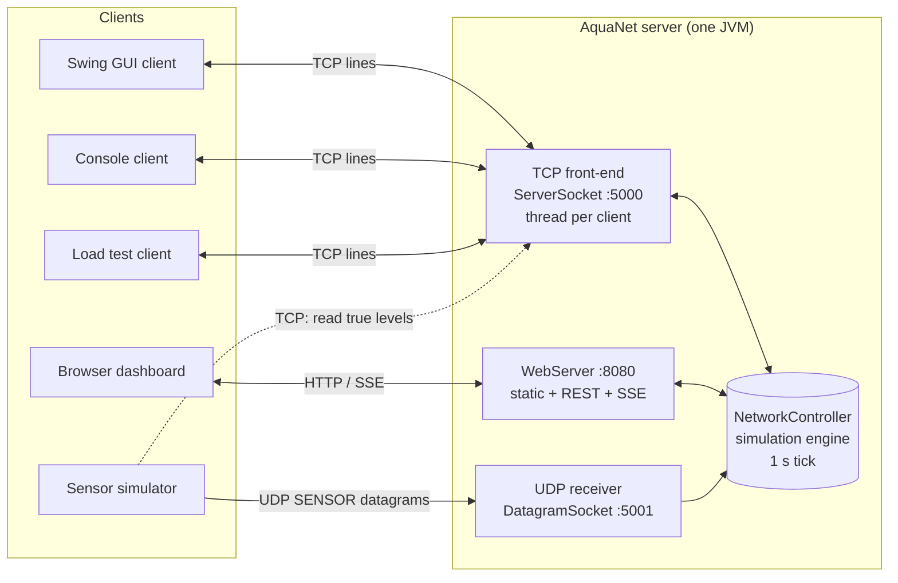
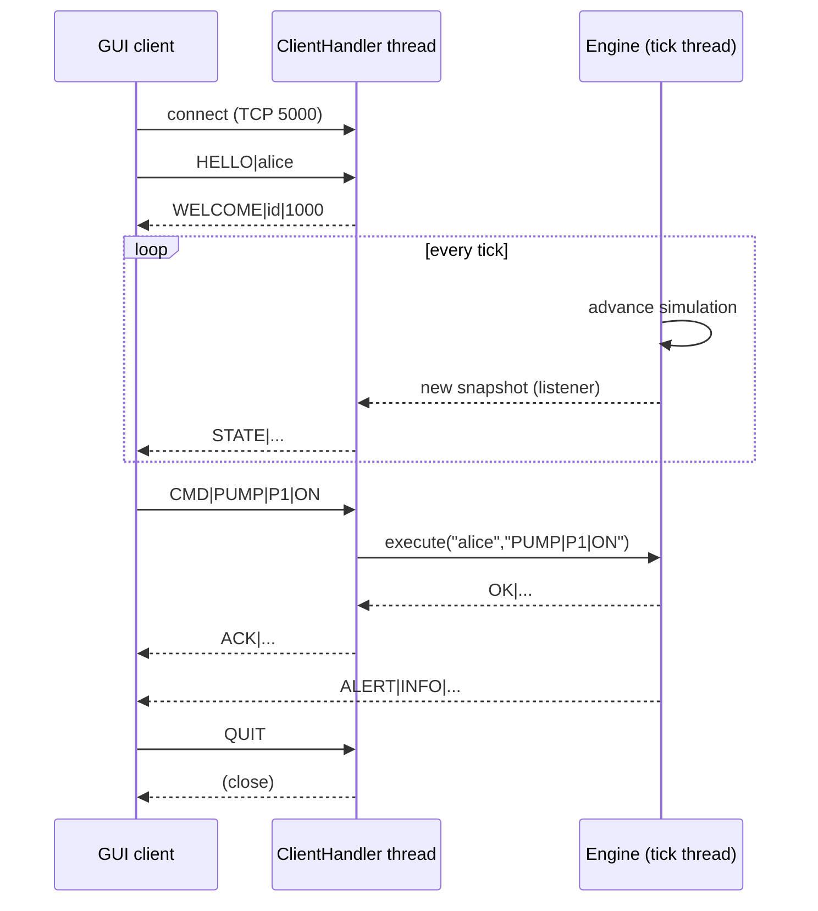

# AquaNet - Real-Time Water Tank & Distribution Network Simulator

**Course:** Network Programming  
**Language / Platform:** Java 11 (no external libraries), Eclipse IDE  
**Team:** [TEAM TO FILL - names and roll numbers]  
**Supervisor:** [TEAM TO FILL]  
**Institution / Department:** [TEAM TO FILL]  
**Date:** [TEAM TO FILL]

---

## Table of Contents

1. Abstract
2. Introduction and Problem Statement
3. Objectives
4. Scope
5. Background and Literature Review
6. System Requirements
7. System Architecture
8. Module Design
9. Protocol Specification
10. Threading Model
11. Simulation Model and Equations
12. Testing
13. Results
14. Limitations
15. Future Work
16. Conclusion
17. References
18. Appendices

---

## 1. Abstract

AquaNet is a distributed, real-time simulator of a small water storage and distribution network. A central **server** simulates three tanks (T1 Main Reservoir, T2 District A, T3 District B), one pump (P1) and two valves (V1: T1 to T2, V2: T1 to T3). The simulation advances once per second and can run in AUTO mode (the server controls the pump and valves with simple rules) or MANUAL mode (operators decide). Operators can inject leaks, and the server raises alerts for low, high, empty and overflow conditions.

The system is built entirely on the standard Java networking API and demonstrates three network paradigms at the same time:

* **TCP** (port 5000): many Swing GUI clients and console clients connect to the server, send commands and receive a `STATE` message pushed every second. The server is multi-threaded (one thread per client).
* **UDP** (port 5001): simulated field sensors send small, periodic level readings as datagrams. UDP is used because readings are frequent and perishable and a lost reading is simply replaced by the next one.
* **HTTP + Server-Sent Events** (port 8080): a lightweight web server built on the JDK's own `com.sun.net.httpserver` serves a website, a browser dashboard, a REST API and a live event stream, so that the network can also be monitored from any browser without installing the client.

The web package needs no external library: the JDK ships `com.sun.net.httpserver.HttpServer`. Supporting tools include a load-test client, a console client and a protocol self-test. The project shows how sockets, protocol design, multithreading, synchronization and GUI threading fit together in a single working application. [TEAM TO FILL - one sentence with the headline test result, e.g. "The server sustained N concurrent clients with STATE latency below X ms."]

**Keywords:** sockets, TCP, UDP, multithreading, client-server, Server-Sent Events, real-time simulation, Java.

---

## 2. Introduction and Problem Statement

### 2.1 Introduction

Water distribution systems consist of reservoirs, pumps, valves and pipes that must be monitored continuously. Operators need an up-to-date picture of tank levels and equipment status, must be able to act remotely (start a pump, open a valve) and must be told immediately when something is wrong (a leak, a tank about to overflow). This is a classic example of a **networked, real-time monitoring and control system** (similar in spirit to SCADA systems).

Building such a system is a good vehicle for learning network programming because it forces us to answer real design questions: which transport protocol suits which data, how to let many clients share one live state, how to avoid data corruption when many threads touch the same object, and how to keep a GUI responsive while the network is busy.

### 2.2 Problem Statement

> Design and implement a client-server application in Java, using only the standard library, that simulates a water tank network in real time and allows multiple remote users and sensors to monitor and control it over TCP, UDP and HTTP, while remaining correct under concurrent access and resilient to client disconnects and lost packets.

### 2.3 Motivation

* Textbook sockets examples (echo servers, simple chat) hide many practical issues. A live simulation with a periodic broadcast, command handling, and unreliable sensor data exposes them.
* Mixing TCP and UDP in one system lets us compare them in a realistic setting rather than in theory only.
* A web dashboard using plain HTTP and SSE shows how a "web" feature is really just another socket protocol.

---

## 3. Objectives

1. Implement a multi-threaded TCP server that supports many simultaneous clients with a simple, text-based, line-oriented protocol.
2. Implement a UDP receiver and sensor simulator that demonstrate connectionless, unreliable delivery, including deliberate packet loss and a faulty-sensor mode.
3. Implement a minimal HTTP/1.1 server with static files, a REST API and Server-Sent Events, without external libraries.
4. Model the water network (tanks, pump, valves, demand, leaks) with a deterministic, tick-based simulation and AUTO/MANUAL control modes.
5. Provide a Swing GUI client that visualises the network and never blocks the Event Dispatch Thread (EDT).
6. Guarantee thread safety of shared state and clean handling of disconnects.
7. Provide tools and tests (console client, load tester, protocol self-test) that verify behaviour.
8. Document the design well enough that a new student can run, understand and extend the project.

---

## 4. Scope

### 4.1 In scope

* One simulated network with 3 tanks, 1 pump, 2 valves (the code is structured so more can be added; see the Developer Guide).
* TCP line protocol, UDP sensor datagrams, HTTP/SSE/REST on the three ports 5000, 5001, 8080.
* Commands: pump on/off, valve opening percentage, AUTO/MANUAL mode, leak inject/repair, reset, chat, ping.
* Alerts (INFO, WARN, CRIT) broadcast to all clients.
* Runs on one machine (localhost) or across a LAN.

### 4.2 Out of scope

* Real hydraulics (pressure, pipe friction, water hammer). The model is a simplified mass-balance model.
* Security (encryption, authentication, authorization).
* Persistence (database, log replay).
* Internet-scale deployment, load balancing, or high availability.

---

## 5. Background and Literature Review

### 5.1 The client-server model

In the client-server model a long-running **server** offers a service at a well-known address (IP + port) and any number of **clients** initiate requests. AquaNet's server owns the single authoritative state of the simulation; clients are thin views and remote controls. This avoids consistency problems: there is one truth.

### 5.2 Sockets

A **socket** is one end point of a two-way communication link, identified by an IP address and a port number. Java exposes sockets through `java.net`:

| Class | Transport | Used for in AquaNet |
|-------|-----------|---------------------|
| `ServerSocket` | TCP, passive (listening) | Server accept loop on 5000 (the JDK `HttpServer` on 8080 uses one internally) |
| `Socket` | TCP, active / connected | GUI client, console client, load tester, sensor gateway link |
| `DatagramSocket` | UDP | Sensor sender and server receiver on 5001 |
| `DatagramPacket` | UDP | One sensor reading = one datagram |

### 5.3 TCP versus UDP

| Property | TCP (RFC 793) | UDP (RFC 768) |
|----------|---------------|---------------|
| Connection | Connection-oriented (3-way handshake) | Connectionless |
| Reliability | Acknowledgements, retransmission | None; datagrams may be lost |
| Ordering | In-order byte stream | No ordering; may be reordered |
| Duplicates | Removed | Possible |
| Message boundaries | None (a stream; the application must frame messages) | Preserved (one datagram = one message) |
| Flow/congestion control | Yes | No |
| Overhead | Higher (20-byte header, state per connection) | Low (8-byte header) |
| Typical use | Commands, file transfer, web | Telemetry, DNS, streaming, games |

**Why AquaNet uses both.** Commands and state broadcasts must not be lost or reordered, so they use TCP. Sensor readings are small, sent every second and become useless when stale; a retransmitted old level would be worse than waiting for the next fresh one. So sensors use UDP, and a sequence number lets the receiver detect gaps.

Because TCP is a stream, the application must **frame** messages. AquaNet uses the simplest robust framing: one message per text line terminated by `\n`, read with `BufferedReader.readLine()`.

### 5.4 Multithreading and concurrency

A blocking call such as `ServerSocket.accept()` or `readLine()` halts its thread until data arrives. A single-threaded server could therefore serve only one client at a time. The classic remedy is **thread-per-connection**: the main thread loops on `accept()` and hands each new `Socket` to a new thread. Thread-per-connection is simple and perfectly adequate for tens or hundreds of clients; for thousands, thread pools or non-blocking I/O (NIO) are preferred (Goetz et al., 2006).

Shared mutable state (the simulation) is accessed by many threads. Without synchronization this causes **race conditions** and **visibility problems**. Java offers `synchronized`, `volatile`, `java.util.concurrent` collections and atomics. AquaNet's approach: keep the simulation state behind one lock (or use immutable snapshots), and hand immutable `NetworkSnapshot` objects to other threads.

Swing is single-threaded: all GUI updates must run on the Event Dispatch Thread, so network threads must use `SwingUtilities.invokeLater(...)`.

### 5.5 HTTP and Server-Sent Events

HTTP (RFC 9110) is a text-based request/response protocol running over TCP. A request is a request line, headers, an empty line and an optional body; a response is a status line, headers, an empty line and a body. Because HTTP is just text over a TCP socket, a basic server needs nothing beyond the JDK; AquaNet uses the built-in `com.sun.net.httpserver.HttpServer`, which does the request parsing and leaves us to write the handlers.

**Server-Sent Events (SSE)** is part of the WHATWG HTML Living Standard. The browser opens a normal HTTP request (`Accept: text/event-stream`); the server answers with `Content-Type: text/event-stream` and keeps the connection open, writing events of the form:

```
event: state
data: {"tick":42, ...}

```

(a blank line ends each event). The browser's `EventSource` object parses them and reconnects automatically. SSE is one-directional (server to browser), which is exactly what a live dashboard needs. **WebSocket** is bidirectional and has its own handshake and framing; it is more complex to implement by hand, so for a read-mostly dashboard SSE plus plain REST `POST` for commands is simpler.

### 5.6 Real-time systems

A *real-time* system must respond within bounded time. AquaNet is a **soft real-time** system: a fixed **tick** (1 second) drives the simulation, and clients should see every state within a small multiple of that tick. Missing a deadline degrades the experience but does not cause failure. The design uses a fixed-rate scheduler for the tick and push-based delivery (the server pushes `STATE` instead of clients polling).

### 5.7 Related systems

SCADA systems (supervisory control and data acquisition) and industrial protocols (Modbus/TCP, MQTT) solve the same class of problem at industrial scale. AquaNet is a teaching-scale analogue. [TEAM TO FILL - add 1-2 papers or articles you actually read.]

---

## 6. System Requirements

### 6.1 Functional requirements

| ID | Requirement |
|----|-------------|
| FR1 | The server shall accept multiple simultaneous TCP clients on port 5000. |
| FR2 | A client shall identify itself with `HELLO\|name` and receive `WELCOME`. |
| FR3 | The server shall push a `STATE` message to every connected client once per tick (1 s). |
| FR4 | A client shall be able to switch pump P1 on/off. |
| FR5 | A client shall be able to set each valve's opening between 0 and 100 %. |
| FR6 | A client shall be able to switch between AUTO and MANUAL mode. |
| FR7 | A client shall be able to inject and repair a leak in a tank. |
| FR8 | The server shall raise alerts (INFO/WARN/CRIT) and broadcast them to all clients and the web stream. |
| FR9 | Clients shall be able to chat; the server relays chat to all clients. |
| FR10 | The server shall receive UDP sensor datagrams on port 5001 and record the last measured value per tank. |
| FR11 | The sensor simulator shall support configurable interval, packet-loss probability and a faulty-sensor mode. |
| FR12 | The server shall serve a web dashboard, a REST API and an SSE stream on port 8080. |
| FR13 | The GUI client shall display tank levels, equipment status, alerts and allow control. |
| FR14 | The server shall detect client disconnects and release their resources. |
| FR15 | Invalid or malformed commands shall be answered with `ERR\|...` and shall never crash the server. |
| FR16 | The system shall provide a console client, a load-test client and a protocol self-test. |

### 6.2 Non-functional requirements

| ID | Category | Requirement |
|----|----------|-------------|
| NFR1 | Portability | Java 11, standard library only; runs on Windows, Linux, macOS. |
| NFR2 | Performance | Support at least [TEAM TO FILL, e.g. 50] concurrent clients with tick jitter below [TEAM TO FILL] ms. |
| NFR3 | Reliability | One failing client must not affect others; the server must survive abrupt disconnects. |
| NFR4 | Responsiveness | The GUI must never block the EDT on network I/O. |
| NFR5 | Thread safety | Simulation state must be consistent under concurrent commands. |
| NFR6 | Usability | Start with default arguments and no configuration; clear error messages. |
| NFR7 | Maintainability | Packages separated by responsibility; the `common` package has no dependencies on others. |
| NFR8 | Observability | Server logs connections, commands and alerts. |
| NFR9 | Robustness | Lost/duplicated/reordered UDP datagrams shall not corrupt state. |

### 6.3 Hardware / software

* JDK 11 or later, Eclipse IDE for Java Developers (any recent version).
* Any modern web browser supporting `EventSource`.
* Optional: two or more computers on the same LAN for a distributed demo.

---

## 7. System Architecture

### 7.1 Overview

The architecture is a **hub-and-spoke** (star) client-server system. The server hosts the simulation engine and three network front-ends: a TCP front-end for GUI/console clients, a UDP front-end for sensors, and an HTTP front-end for browsers. All front-ends talk to the engine through the `NetworkController` interface defined in `aquanet.common`.

### 7.2 ASCII diagram

```
                         +--------------------------------------------------+
                         |                  AquaNet SERVER                  |
                         |                                                  |
 +--------------+  TCP   |  +-------------+                                 |
 | Swing GUI    |<------>|  | TCP front   |   thread per client             |
 | client #1..n |  5000  |  | (accept loop|--+                              |
 +--------------+        |  |  + handlers)|  |                              |
 +--------------+  TCP   |  +-------------+  |    +----------------------+  |
 | Console      |<------>|                   +--->|  NetworkController   |  |
 | client       |        |  +-------------+  |    |  (simulation engine) |  |
 +--------------+        |  | HTTP front  |--+    |  tanks, pump, valves |  |
 +--------------+  HTTP  |  | (WebServer) |  |    |  tick timer 1 s      |  |
 | Browser      |<------>|  | static+REST |<-+    |  alerts, leaks       |  |
 | dashboard    |  8080  |  | +SSE        |       +----------+-----------+  |
 +--------------+  (SSE) |  +-------------+                  ^              |
                         |                                   | last measured|
 +--------------+  UDP   |  +-------------+                  |              |
 | Sensor       |------->|  | UDP front   |------------------+              |
 | simulator    |  5001  |  | (receiver)  |                                 |
 +--------------+        |  +-------------+                                 |
        ^                +--------------------------------------------------+
        | (TCP 5000: sensor gateway reads true levels to fake realistic readings)
        +---------------------------------------------------------------------
```

### 7.3 Mermaid diagram





### 7.4 Port summary

| Port | Transport | Purpose |
|------|-----------|---------|
| 5000 | TCP | GUI/console clients, load tester, sensor gateway link |
| 5001 | UDP | Sensor datagrams |
| 8080 | TCP (HTTP) | Website, REST API, SSE stream |

### 7.5 Design decisions

* **Single source of truth** on the server; clients are stateless views.
* **Push, not poll**: the server broadcasts `STATE` every tick, so all clients see the same tick.
* **Immutable snapshots** (`NetworkSnapshot`, `TankInfo`, `PumpInfo`, `ValveInfo`) are passed between threads, which removes most locking from the front-ends.
* **Interface-based decoupling**: `NetworkController` is the only API front-ends use; the TCP, HTTP and test code never touch simulation internals.
* **Text protocols** are easy to debug with `telnet`/`nc`/browser.

---

## 8. Module Design

### 8.1 Package overview

| Package | Responsibility |
|---------|----------------|
| `aquanet.common` | Shared protocol constants and helpers (`Protocol`), the controller contract (`NetworkController`), and immutable data objects (`NetworkSnapshot`, `TankInfo`, `PumpInfo`, `ValveInfo`) including wire and JSON encoding. |
| `aquanet.server` | `AquaNetServer` (main class, accept loop, broadcast), `SimulationEngine` (physics, AUTO controller, alerts, tick scheduler), `ClientHandler` (one TCP client: reader + writer thread), `SensorUdpListener` (UDP receiver with loss statistics). |
| `aquanet.client` | Swing GUI client: `AquaNetClient` (main), `DashboardFrame` (main window), `ConnectionManager` (socket and reader thread, reconnect, ping), `TankPanel`, `NetworkDiagramPanel`, `TrendChartPanel`, `ControlPanel`, `AlertChatPanel`, `Theme`. |
| `aquanet.sensor` | `SensorSimulator`: UDP sensor generator with loss and fault simulation. |
| `aquanet.web` | `WebServer`: HTTP server on the JDK's `com.sun.net.httpserver` (static files from `web/`, REST endpoints, SSE stream). |
| `aquanet.test` | `LoadTestClient`, `ConsoleClient`, `ProtocolSelfTest`. |

### 8.2 Server module

Responsibilities:

1. Own the simulation state and advance it each tick.
2. Listen on TCP 5000; for every accepted `Socket` start a handler thread that reads command lines and writes replies.
3. Broadcast `STATE` to all handlers each tick and `ALERT` on events.
4. Receive UDP datagrams, validate them and update the last-measured value of the tank.
5. Track the number of connected clients (included in each snapshot).

Key design points (as implemented):

* `SimulationEngine` implements `NetworkController`; the network classes see only that interface.
* The engine runs on a single-thread `ScheduledExecutorService` using `scheduleAtFixedRate`, so the 1 s period stays steady. Exceptions in a tick are caught so the schedule is never cancelled silently.
* `AquaNetServer` keeps the connected handlers in a `CopyOnWriteArrayList` and runs each `ClientHandler` on a cached thread pool.
* Broadcast is non-blocking: the engine's listener only places a line into each client's bounded outbox queue (capacity 200). A separate writer thread per client does the socket write. A frozen client therefore only loses its own lines and can never stall the tick.
* The web server is started through reflection, so the server still runs if the `web` package is missing (also available as the `--no-web` flag).

### 8.3 Client module (Swing GUI)

* A **network thread** performs `connect`, reads lines, and parses `STATE`, `ALERT`, `ACK`, `ERR`, `CHAT`.
* All widget updates are wrapped in `SwingUtilities.invokeLater`.
* Commands are written through `ConnectionManager`, which serialises writes with a lock. `ConnectionManager` also pings every 5 s to show the round-trip time and reconnects automatically with exponential back-off (1, 2, 4 ... max 15 s).
* Displays: animated tank panels coloured by status, a schematic pipe diagram, a live trend chart of fill percentages, an alert log, a chat box and connection status.
* Controls (built dynamically from the snapshot, so extra tanks/pumps/valves appear automatically): pump ON/OFF toggle, valve sliders (command sent when the slider is released), AUTO/MANUAL toggle, leak inject/repair buttons, reset.

### 8.4 Sensor module

`SensorSimulator` sends one UDP datagram per tank per interval: `SENSOR|tankId|levelLitres|seq`. To make readings realistic it opens a TCP connection to the server (as client `sensor-gw`) to learn the true levels, then adds about 1 % Gaussian noise. Options: `--loss P` drops datagrams with probability P, `--fault TANKID` makes that tank's sensor occasionally report impossible values, `--udp PORT` selects the server UDP port. The sequence number increments even for dropped packets so the receiver can see the gaps.

### 8.5 Web module

* `WebServer` uses `com.sun.net.httpserver.HttpServer` on port 8080 with a cached thread pool (an open SSE stream occupies one worker for its lifetime).
* Static files are served from the `web/` folder (home page, `dashboard.html`, `architecture.html`, `download.html`, `about.html`, CSS, JavaScript) with path-traversal protection.
* REST endpoints return JSON generated by `NetworkSnapshot.toJson()`; the command endpoint calls `NetworkController.execute("web", ...)`.
* The SSE endpoint keeps the response open and writes a `state` event every tick and an `alert` event for every alert, using `addStateListener` / `addEventListener`. The simulation thread only queues strings; each SSE worker thread does its own writing.
* The server keeps a ring buffer of the last 120 snapshots (tank percentages) and the last 50 alerts so a freshly opened dashboard can draw history immediately.
* The exact endpoint list is given in Section 9.5.

### 8.6 Common module

The `common` package is the contract between all other packages and has no dependency on them.

* `Protocol` - ports, tick length, message keywords, `split`, `join`, `clean` (strips `|` and newlines so user text cannot break framing).
* `NetworkController` - `snapshot()`, `execute(who, command)`, `addStateListener`, `addEventListener`.
* `NetworkSnapshot` - immutable picture of one tick, with `toWire()` / `fromWire()` and `toJson()`.
* `TankInfo` - level, capacity, inflow, outflow, measured value, leaking flag, and a derived `status()` (EMPTY, LOW, OK, HIGH, OVERFLOW).
* `PumpInfo`, `ValveInfo` - equipment state.

### 8.7 Test tools module

* `ConsoleClient` - text-mode client (stdin commands such as `pump P1 on`, prints server messages).
* `LoadTestClient` - opens many simultaneous headless connections; each sends PING every 500 ms and prints a table of STATE count and round-trip time per client.
* `ProtocolSelfTest` - self-contained checks (no server needed) of wire round trips, tank status thresholds, JSON well-formedness and `Protocol` helpers.

---

## 9. Protocol Specification

General rules:

* Encoding **UTF-8**. Each TCP message is **one line** terminated by `\n`. Fields are separated by `|`. The `|` character and line breaks must not appear inside fields (`Protocol.clean` replaces them).
* Keywords are upper-case.
* The first client message must be `HELLO`.

### 9.1 TCP: client to server

| Message | Format | Description | Typical reply |
|---------|--------|-------------|---------------|
| HELLO | `HELLO\|name` | Register with a display name (first message). | `WELCOME` |
| CMD (pump) | `CMD\|PUMP\|P1\|ON` or `OFF` | Switch the pump. | `ACK` or `ERR` |
| CMD (valve) | `CMD\|VALVE\|V1\|75` | Set the valve opening, 0 to 100 %. | `ACK` or `ERR` |
| CMD (mode) | `CMD\|MODE\|AUTO` or `MANUAL` | Choose control mode. | `ACK` or `ERR` |
| CMD (leak) | `CMD\|LEAK\|T2\|ON` or `OFF` | Inject or repair a leak in a tank. | `ACK` or `ERR` |
| CMD (reset) | `CMD\|RESET` | Return the simulation to its starting state (levels, pump off, valves 50 %, AUTO mode, leaks repaired). | `ACK` |
| CHAT | `CHAT\|text` | Send a chat message to all clients. | broadcast `CHAT` |
| PING | `PING` | Liveness / latency test. | `PONG` |
| QUIT | `QUIT` | Graceful disconnect. | `ACK\|bye`, then the connection is closed |

### 9.2 TCP: server to client

| Message | Format | Description |
|---------|--------|-------------|
| WELCOME | `WELCOME\|clientId\|tickMillis` | Sent after HELLO; tells the client its id (`C1`, `C2`, ...) and the tick length (1000 ms). It is followed immediately by one `STATE` so a new client sees a picture without waiting for the next tick. |
| STATE | `STATE\|<snapshot wire string>` | Pushed every tick. See 9.3. |
| ALERT | `ALERT\|LEVEL\|message` | Event notification. LEVEL is `INFO`, `WARN` or `CRIT`. |
| ACK | `ACK\|message` | Command accepted. |
| ERR | `ERR\|message` | Command or message rejected. |
| CHAT | `CHAT\|from\|text` | Chat message broadcast to all clients (including the sender). |
| PONG | `PONG` | Reply to PING. |

### 9.3 Snapshot wire format

```
tick#mode#clients#tank;tank;...#pump;pump#valve;valve
```

Records are comma-separated:

| Record | Fields (in order) |
|--------|-------------------|
| tank | `id, name, level, capacity, inflow, outflow, measured, leaking(0/1)` |
| pump | `id, name, on(0/1), flowRate` |
| valve | `id, name, openPercent, fromTankId, toTankId` |

Numbers are formatted with two decimals using `Locale.ROOT` (decimal point, never a comma). `measured` is `-1.00` when no sensor reading has been received in the last 5 seconds. Names have `,` and `|` removed so they cannot break parsing.

Example (illustrative):

```
STATE|120#AUTO#2#T1,Main Reservoir,6000.00,10000.00,0.00,60.00,-1.00,0;T2,District A,2000.00,4000.00,30.00,22.00,-1.00,0;T3,District B,2500.00,4000.00,30.00,20.00,-1.00,0#P1,Source Pump,0,0.00#V1,Valve T1-T2,50,T1,T2;V2,Valve T1-T3,50,T1,T3
```

### 9.4 UDP: sensor to server

| Message | Format | Description |
|---------|--------|-------------|
| SENSOR | `SENSOR\|tankId\|levelLitres\|seq` | One datagram per reading; `seq` is a per-tank counter increasing by 1. |

The UDP receiver never replies (no handshake, no ACK). The sequence number lets the server count lost, duplicated or out-of-order datagrams. Datagrams are ignored (and counted as *malformed*) if they do not have exactly 4 fields, do not start with `SENSOR`, contain an unparsable or negative number, or name an unknown tank. The datagram buffer is 512 bytes. The listener keeps per-tank statistics (received, lost, out-of-order, duplicate) from the sequence numbers and logs a summary every 10 s. A valid reading only updates the `measured` field; it never changes the true simulated level. Note that a faulty value above the tank capacity is syntactically valid and is stored as the measurement, which makes it visible next to the true level on the dashboards.

### 9.5 HTTP / REST / SSE

Implemented in `aquanet.web.WebServer` (port 8080):

| Method | Path | Purpose |
|--------|------|---------|
| GET | `/` | `web/index.html`; any other path is served as a static file from `web/` (403 for `..` paths, 404 if missing) |
| GET | `/api/state` | Current snapshot as JSON (`NetworkSnapshot.toJson()`) |
| GET | `/api/history` | JSON array of the last 120 snapshots' tank fill percentages |
| GET | `/api/alerts` | JSON array of the last 50 alerts: `{"time","level","message"}` |
| POST | `/api/command` | Body is plain text, e.g. `PUMP\|P1\|ON` (same grammar as `NetworkController.execute`, without the `CMD\|` prefix). Reply: `{"ok":true/false,"message":"..."}` |
| GET | `/events` | Server-Sent Events: `event: state` (JSON snapshot every tick) and `event: alert` (JSON alert), `retry: 2000`, and a `: keep-alive` comment after 15 s of silence |

Example SSE frames:

```
retry: 2000

event: state
data: {"tick":120,"mode":"AUTO", ...}

event: alert
data: {"time":"14:03:11","level":"WARN","message":"T3 below 20%"}

```

JSON snapshot shape (from `toJson()`):

```json
{"tick":120,"mode":"AUTO","clients":2,
 "tanks":[{"id":"T1","name":"Main Reservoir","level":6000.00,"capacity":10000.00,
           "percent":60.00,"inflow":0.00,"outflow":60.00,"measured":-1.00,
           "leaking":false,"status":"OK"}],
 "pumps":[{"id":"P1","name":"Source Pump","on":false,"flowRate":0.00}],
 "valves":[{"id":"V1","name":"Valve T1-T2","open":50,"from":"T1","to":"T2"}]}
```

### 9.6 Tank status thresholds (from `TankInfo.status()`)

| Status | Condition |
|--------|-----------|
| EMPTY | level <= 0.5 L |
| OVERFLOW | fill >= 99.5 % |
| LOW | fill < 20 % |
| HIGH | fill > 90 % |
| OK | otherwise (evaluated in the order above) |

### 9.7 Error handling in the protocol

* Any message other than `HELLO`, `PING` or `QUIT` before `HELLO`: `ERR|send HELLO|name first`.
* Unknown keyword: `ERR|unknown message 'FOO'`.
* `CMD` with no body: `ERR|missing command`.
* Bad command: `ERR|usage: ...`, `ERR|unknown pump 'P9'`, `ERR|valve opening must be between 0 and 100`, and so on. The connection stays open.
* Command replies from the engine are `OK|text` / `ERR|text`; the TCP handler translates `OK|text` into `ACK|text`. The web API returns them as JSON.
* Keywords are case-insensitive on the server (`cmd`, `pump`, `on` all work), but the documented form is upper-case.
* Pump or valve commands issued in AUTO mode first switch the system to MANUAL (the reply says so), otherwise the AUTO controller would immediately undo the operator's action.
* A full per-client outbox (200 lines) causes further `STATE`/`ALERT` lines for that client to be dropped rather than blocking the server.

---

## 10. Threading Model

| Thread | Count | Role | Blocking operation |
|--------|-------|------|--------------------|
| `main` (server) | 1 | Starts all components, then runs the TCP accept loop | `ServerSocket.accept()` |
| `sim-tick` | 1 | Fixed-rate loop: AUTO controller, physics, alerts, snapshot, notify listeners | scheduler wait |
| client handler (reader) | 1 per TCP client, from a cached pool | Read lines, execute commands, queue replies | `BufferedReader.readLine()` |
| `client-writer-Cn` | 1 per TCP client | Take lines from the client's outbox queue and write them to the socket | `BlockingQueue.poll()` |
| `udp-sensor` | 1 | Receive datagrams, update `measured`, keep loss statistics | `DatagramSocket.receive()` (1 s timeout) |
| `web-worker-n` | cached pool | HTTP request handlers; every open SSE stream holds one for its lifetime | socket read/write, queue poll |
| `shutdown-hook` | 1 | Orderly shutdown on Ctrl+C | n/a |
| (GUI client) reader | 1 | Read server messages, parse them, hand them to the EDT | `readLine()` |
| (GUI client) `aquanet-pinger` | 1 | PING every 5 s for round-trip time | scheduler wait |
| (GUI client) EDT | 1 | All Swing painting and widget updates | must never block |

### 10.1 Shared state and synchronization

* **Simulation state** (`SimulationEngine`) is mutated by the tick thread (every tick), by handler / web threads (commands via `execute`) and by the UDP thread (`updateSensor`). **All mutable state is guarded by one lock object**, held for as short a time as possible.
* **Listeners are never called while the lock is held.** Events are collected in a local list inside the lock and fired after it is released. Therefore network I/O can never be performed under the lock, which prevents deadlock and stops a slow client from freezing the simulation.
* **Snapshots are immutable** (`NetworkSnapshot`, `TankInfo`, `PumpInfo`, `ValveInfo` have only `final` fields and unmodifiable lists), so they are passed to any thread without locking.
* **Client registry** and **listener lists** are `CopyOnWriteArrayList`, safe to iterate while other threads add or remove entries.
* **Per-client outbox** is a bounded `LinkedBlockingQueue` (capacity 200). The producer (tick thread) uses `offer()` which never blocks; the single writer thread per client also guarantees that two lines are never interleaved on the wire.
* **Flags** such as `running` and `closed` are `volatile`.
* **Web server**: SSE client list is a `CopyOnWriteArrayList`; the history and alert ring buffers are protected by their own monitors; each SSE client has its own queue.
* **GUI client**: `ConnectionManager` serialises socket writes with a lock and uses a "generation" counter so a stale reader thread from an old connection cannot report events after a reconnect. All Swing updates go through `SwingUtilities.invokeLater`.

### 10.2 Deadlock and starvation considerations

* One engine lock only, no nested locks, and no calls to foreign code (listeners, sockets) while holding it.
* A frozen peer cannot block anyone: queues are bounded and `offer()` is non-blocking.
* `scheduleAtFixedRate` keeps the tick period steady; exceptions are caught inside `safeTick` so one bad tick does not cancel future ticks.

### 10.3 Disconnect handling

* Graceful: the client sends `QUIT`; the handler answers `ACK|bye` and leaves its loop.
* Abrupt (process killed, cable pulled): `readLine()` returns `null` or throws `IOException`; the writer thread also fails on its next write and calls `close()`.
* In every case the handler's `finally` block runs `close()` (idempotent: marks closed, wakes the writer thread with a close marker, closes the socket) and `server.clientGone(this)`, which removes the handler from the registry and updates the client count shown in `STATE`. Other clients are not affected.
* A completely silent dead peer (no TCP reset) is detected later by TCP itself or when its outbox overflows; [TEAM TO FILL - mention if you tested this].

---

## 11. Simulation Model and Equations

The simulation is a discrete-time **mass-balance** model implemented in `aquanet.server.SimulationEngine`. Time advances in ticks of `dt = 1 s` (`Protocol.TICK_MILLIS = 1000`).

```
   [external source] --P1--> T1 (Main Reservoir) --V1--> T2 (District A) --> demand
                                                  \--V2--> T3 (District B) --> demand
```

### 11.1 Constants (from the source)

| Constant | Value |
|----------|-------|
| Capacity T1 / T2 / T3 | 10 000 L / 4 000 L / 4 000 L |
| Initial level T1 / T2 / T3 | 6 000 L / 2 000 L / 2 500 L |
| Pump P1 rate `Q_pump` | 80 L/s (draws from an unlimited external source) |
| Max flow of a fully open valve `Q_vmax` | 60 L/s |
| Leak rate `Q_leak` | 18 L/s |
| Demand T2 | base 22 L/s, amplitude 9 L/s, phase 0 |
| Demand T3 | base 20 L/s, amplitude 8 L/s, phase 2.1 rad |
| T1 demand | none |
| Initial valve opening | 50 % each; pump OFF; mode AUTO |
| Sensor timeout | 5 s (older readings are shown as offline, `-1`) |
| AUTO valve step | at most 10 percentage points per tick |

### 11.2 Order of calculation in one tick

1. `tick++`
2. If mode is AUTO: run the AUTO controller (section 11.4).
3. Physics step (below).
4. Detect status changes and produce alerts (section 11.3).
5. Build the immutable snapshot (under the lock).
6. After releasing the lock: fire alert events, then call the state listeners.

### 11.3 Physics step

For every valve *k* (from tank *a* to tank *b*, opening `o_k` in percent):

```
want_k   = (o_k / 100) * Q_vmax * dt
moved_k  = max(0, min( want_k , L_a , C_b - L_b ))     // limited by source water and free space
L_a -= moved_k ;  outflow_a += moved_k/dt
L_b += moved_k ;  inflow_b  += moved_k/dt
```

For the pump (if ON):

```
pumped   = max(0, min( Q_pump * dt , C_T1 - L_T1 ))     // cannot exceed capacity
L_T1 += pumped ; inflow_T1 += pumped/dt ; pump.flow = pumped/dt
```

For every tank with demand (T2, T3):

```
d(t) = base + amp * sin( 2*pi*t/90 + phase ) + N(0, 1.5^2)     // L/s, period 90 s
drain = min( max(0, d(t)) * dt , L )
L -= drain ; outflow += drain/dt
```

If a tank is leaking, an additional `drain = min(Q_leak * dt, L)` is taken. All levels are therefore kept within `[0, C]`.

Summarised as a balance for each tank *i*:

```
L_i(t+dt) = L_i(t) + (Q_in,i - Q_out,i) * dt          with 0 <= L_i <= C_i
Q_in,T1  = pump flow                  Q_out,T1 = Q_V1 + Q_V2 (+ leak)
Q_in,T2  = Q_V1                       Q_out,T2 = demand_T2 (+ leak)
Q_in,T3  = Q_V2                       Q_out,T3 = demand_T3 (+ leak)
```

The `inflow` and `outflow` in `TankInfo` are these per-tick figures in L/s. Valves are processed first and the pump second, so a tank that is empty at the start of a tick cannot pass water on in the same tick.

**Conservation check (useful for a test):** valves only move water between tanks. Without leak and without clamping, the total volume changes only by `pumped - sum(demand drains)`.

### 11.4 Tank status and alerts

Percent full `p = 100 * L / C`. Status (first matching rule): EMPTY if `L <= 0.5`; OVERFLOW if `p >= 99.5`; LOW if `p < 20`; HIGH if `p > 90`; otherwise OK.

An alert is generated only when a tank's status **changes** (de-duplication, so no alert flood):

| New status | Alert |
|------------|-------|
| EMPTY | `CRIT` "T? is EMPTY" |
| OVERFLOW | `CRIT` "OVERFLOW - water wasted" |
| LOW | `WARN` "below 20%" |
| HIGH | `WARN` "above 90%" |
| OK (from another status) | `INFO` "back to normal" |

Other events: `INFO` when a pump is switched or a valve changed by a user, when the mode changes, on RESET; `CRIT` when a leak is injected ("LEAK detected on ..."); `INFO` when a leak is repaired.

### 11.5 Control modes

**MANUAL:** pump and valves change only through operator commands.

**AUTO (runs at the start of each tick):**

| Rule | Condition | Action |
|------|-----------|--------|
| A1 | pump OFF and T1 < 40 % | pump ON (INFO event) |
| A2 | pump ON and T1 > 85 % | pump OFF (INFO event) |
| A3 | downstream tank of valve < 20 % | target opening 100 % |
| A4 | 20 % to 40 % | 80 % |
| A5 | 40 % to 60 % | 60 % |
| A6 | 60 % to 80 % | 40 % |
| A7 | 80 % to 90 % | 20 % |
| A8 | 90 % or more | 0 % |

A1/A2 form a **hysteresis band** (40 % / 85 %), which stops the pump from rapidly switching on and off near a single threshold. Valves move toward their target by at most 10 points per tick (a ramp, no sudden jumps).

A manual pump or valve command received in AUTO mode first switches the system to MANUAL. The operator can return to AUTO with `MODE|AUTO`; `RESET` also sets AUTO.

### 11.6 Leak model and sensors

A leak is injected with `CMD|LEAK|T2|ON`. It adds a constant extra drain of 18 L/s to that tank, so its level falls faster than demand alone explains, and a `CRIT` alert is broadcast. In AUTO mode the controller tries to compensate by opening the valve and starting the pump when T1 gets low; in MANUAL mode the tank will eventually reach LOW and EMPTY, each producing alerts. `CMD|LEAK|T2|OFF` repairs it.

Sensors: the UDP sensor simulator reports `measured = level + N(0, (0.01 * level)^2)` (1 % Gaussian noise). In `--fault` mode about 15 % of readings of the chosen tank are replaced by an impossible value (negative, or between 1.5 and 2.5 times the capacity). The server rejects negative values as malformed. The server never uses sensor values for the physics: the true level stays inside the simulation and `measured` is displayed beside it, so operators can compare the two and spot a faulty sensor or a silent sensor (offline after 5 s).

---

## 12. Testing

### 12.1 Strategy

1. **Unit-level**: `ProtocolSelfTest` checks encode/decode of snapshots and message parsing.
2. **Functional**: manual and scripted checks through the GUI, console client and browser.
3. **Concurrency / load**: `LoadTestClient` with many clients.
4. **Network fault**: UDP loss (`--loss`), faulty sensor (`--fault`), abrupt client termination, server restart.
5. **Cross-machine**: server and clients on different computers.

### 12.2 Test environment

[TEAM TO FILL - OS, JDK version, CPU/RAM, network (localhost / Wi-Fi / LAN), browser version.]

### 12.3 Test plan

| ID | Description | Steps | Expected result | Result (Pass/Fail, notes) |
|----|-------------|-------|-----------------|---------------------------|
| TC01 | Server starts on default ports | Run `aquanet.server.AquaNetServer` with no arguments | Console shows listening on TCP 5000, UDP 5001, HTTP 8080; no exceptions | |
| TC02 | Client connect and handshake | Start the GUI client, connect to localhost | `WELCOME` received; GUI shows "connected" and starts updating | |
| TC03 | STATE broadcast every second | Connect console client; watch for 30 s | A `STATE` line about every 1 s; `tick` increases by 1 each time | |
| TC04 | Pump command | In MANUAL mode send `CMD\|PUMP\|P1\|ON` | `ACK`; P1 shows ON; T1 inflow > 0 in next STATE | |
| TC05 | Valve command | Send `CMD\|VALVE\|V1\|75` | `ACK`; V1 open = 75; T2 inflow increases | |
| TC06 | Invalid command | Send `CMD\|VALVE\|V9\|50`, `CMD\|VALVE\|V1\|abc`, `CMD\|VALVE\|V1\|150`, `FOO` | Each answered with `ERR\|...`; server and connection stay alive | |
| TC07 | Mode switch AUTO/MANUAL | In AUTO let T1 fall below 40 %; then in MANUAL repeat | In AUTO the pump starts by itself (INFO alert); in MANUAL it does not. A manual pump/valve command in AUTO switches the mode to MANUAL | |
| TC08 | Leak injection | Send `CMD\|LEAK\|T2\|ON`; observe T2 | T2 `leaking` = true, outflow rises by about 18 L/s, level falls faster, CRIT alert broadcast | |
| TC09 | Leak repair | Send `CMD\|LEAK\|T2\|OFF` | `leaking` = false; outflow returns to normal | |
| TC10 | Multiple clients see same state | Start 3 GUI clients; change valve in client 1 | Clients 2 and 3 show the change within about 1 s; `clients` field = 3 | |
| TC11 | Alert broadcast | Drive T3 to LOW (MANUAL, close V2 and wait, or inject a leak on T3) | `ALERT` message received by all clients and appears in web stream | |
| TC12 | Chat relay | Client A sends `CHAT\|hello` | All clients, including A, receive `CHAT\|A\|hello` | |
| TC13 | Graceful disconnect | Send `QUIT` | `ACK\|bye`, connection closed; `clients` in STATE decreases; no server error | |
| TC14 | Abrupt disconnect | Kill a client process (or unplug network) | Server removes the client within a few seconds; other clients unaffected | |
| TC15 | UDP sensor reception | Run `SensorSimulator`; watch `measured` | `measured` is close to `level` (about 1 % noise) instead of -1 | |
| TC16 | UDP packet loss | Run `SensorSimulator --loss 0.3` | Server keeps working; some readings missing; measured values still update; gaps in `seq` are noticeable | |
| TC17 | Faulty sensor | Run `SensorSimulator --fault T2` | True level `level` is unaffected; `measured` of T2 occasionally shows a wild value (above capacity) while negative values are rejected as malformed (see UDP summary in the server log) | |
| TC18 | Malformed UDP datagram | Send `hello` or `SENSOR\|T9\|abc\|1` with netcat/`nc -u` | Datagram ignored and counted as malformed in the 10 s UDP summary; server stays alive | |
| TC19 | Web dashboard | Open `http://localhost:8080/` | Page loads; tank values update every second without reload | |
| TC20 | SSE reconnect | Stop and restart the server with the dashboard open | Browser reconnects automatically and resumes updates | |
| TC21 | Web command | Use dashboard control to switch pump | Pump state changes; GUI clients also see it | |
| TC22 | Load test | Run `LoadTestClient localhost 5000 50 60` (50 clients, 60 s; adjust) | All clients receive STATE; tick interval remains about 1 s; no exceptions | |
| TC23 | Protocol self-test | Run `ProtocolSelfTest` | All checks pass | |
| TC24 | Port in use | Start the server twice | Second instance prints `Cannot listen on TCP port 5000: ...` and exits | |
| TC25 | Remote machine | Run server on PC A, GUI on PC B, enter A's IP | Connects and works; firewall rules documented | |

(Add or remove rows to match your final test set. The first 15 are the minimum core set.)

### 12.4 Test procedure notes

* Always record the date, tester name, JDK version and the build/commit in the result column notes.
* For TC14 on Linux/macOS, `kill -9 <pid>` simulates a crash; on Windows use Task Manager "End task".
* For TC18 you can send a datagram with `echo -n "hello" | nc -u -w1 localhost 5001`.

---

## 13. Results

[TEAM TO FILL - all of this section.]

### 13.1 Functional results

Summary table: number of test cases passed / failed / not run.

| Total | Passed | Failed | Not run |
|-------|--------|--------|---------|
| [ ] | [ ] | [ ] | [ ] |

### 13.2 Screenshots

* Figure 13.1 - Server console at start-up
* Figure 13.2 - GUI client with three tanks
* Figure 13.3 - Alert panel during a leak
* Figure 13.4 - Web dashboard
* Figure 13.5 - Wireshark capture of a `STATE` line (TCP) and a `SENSOR` datagram (UDP) (optional but impressive)

### 13.3 Performance measurements

| Metric | Method | Result |
|--------|--------|--------|
| Max concurrent clients tested | LoadTestClient | [ ] |
| Average STATE inter-arrival time | Timestamps in console client | [ ] ms |
| Maximum STATE jitter | as above | [ ] ms |
| PING round-trip time (localhost / LAN) | `PING`/`PONG` | [ ] ms |
| Server CPU / memory under load | OS monitor / VisualVM | [ ] |
| UDP loss observed at `--loss 0.3` | sequence gap counting | [ ] % |

### 13.4 Discussion

[TEAM TO FILL - what worked, surprises, bugs found and fixed, what the numbers mean.]

---

## 14. Limitations

* **No security**: traffic is plain text, there is no login, and any client can control the plant.
* **Thread-per-client** limits scalability to hundreds, not thousands, of clients.
* **Simplified physics**: no pressure, pipe length, pump curves or water quality.
* **No persistence**: all history is lost when the server stops.
* **Single server**: no redundancy or failover; the server is a single point of failure.
* **UDP sensors are unauthenticated**: anyone can spoof readings.
* **Fixed topology** in the default configuration (3 tanks, 1 pump, 2 valves).
* **Text protocol overhead**: larger than a binary protocol; `STATE` is re-sent in full each tick instead of as deltas.
* **The JDK `HttpServer`** is a simple server (`com.sun.net.httpserver` is a supported JDK API but not a full web server): no HTTPS in our configuration, no authentication, one worker thread per open SSE stream.
* **Full `STATE` every second** even if nothing changed; a slow client silently loses lines when its queue (200 lines) is full.
* [TEAM TO FILL - any bugs/limitations discovered during testing]

---

## 15. Future Work

1. **SSL/TLS** - use `SSLServerSocket` / `SSLSocket` (and HTTPS) to encrypt traffic.
2. **Authentication and roles** - login with salted password hashes; viewer vs operator roles; per-command authorization.
3. **Database logging** - store readings, alerts and commands (e.g. SQLite via JDBC, or a flat CSV log) for history charts and audit.
4. **RMI or gRPC-style RPC** as an alternative control channel for comparison.
5. **WebSocket** support for bidirectional dashboard communication.
6. **Non-blocking I/O (NIO)** or a thread pool to handle many more clients.
7. **Delta updates** and binary encoding to reduce bandwidth.
8. **Configurable topology** from a file (tanks, pumps, valves, pipes) instead of code.
9. **More realistic hydraulics**, demand patterns by time of day, weather/rain input.
10. **Leak detection by analytics**: statistical comparison of measured vs expected levels.
11. **Mobile-friendly dashboard** and charts of historical levels.
12. **Sensor authentication** (HMAC on datagrams) and replay protection using the sequence number.
13. **Automated unit tests** with JUnit and CI.

---

## 16. Conclusion

AquaNet brings together the core topics of a network programming course in one coherent application: a multi-threaded TCP server with a well-defined line protocol, unreliable UDP telemetry with loss and fault handling, a hand-written HTTP/SSE web interface, and a responsive Swing client. Separating the simulation behind the `NetworkController` interface and exchanging immutable snapshots kept the concurrency manageable and the design extensible. The project demonstrates the practical trade-offs between TCP and UDP, thread-per-client servers, push versus poll, and SSE versus WebSocket. [TEAM TO FILL - personal reflection: what each member learned, what you would do differently.]

---

## 17. References

1. Oracle. *Java Tutorials: Custom Networking* (All About Sockets, Working with URLs, All About Datagrams). https://docs.oracle.com/javase/tutorial/networking/
2. Goetz, B., Peierls, T., Bloch, J., Bowbeer, J., Holmes, D., Lea, D. *Java Concurrency in Practice*. Addison-Wesley, 2006.
3. Postel, J. (ed.). *RFC 793: Transmission Control Protocol*. IETF, September 1981. https://www.rfc-editor.org/rfc/rfc793
4. Postel, J. *RFC 768: User Datagram Protocol*. IETF, August 1980. https://www.rfc-editor.org/rfc/rfc768
5. Fielding, R., Nottingham, M., Reschke, J. (eds.). *RFC 9110: HTTP Semantics*. IETF, June 2022. https://www.rfc-editor.org/rfc/rfc9110
6. WHATWG. *HTML Living Standard, Section 9.2: Server-sent events*. https://html.spec.whatwg.org/multipage/server-sent-events.html
7. Oracle. *Java SE 11 API Documentation: java.net package*. https://docs.oracle.com/en/java/javase/11/docs/api/java.base/java/net/package-summary.html
8. Oracle. *Java Tutorials: Concurrency* and *Creating a GUI with Swing - Concurrency in Swing*. https://docs.oracle.com/javase/tutorial/
9. Kurose, J., Ross, K. *Computer Networking: A Top-Down Approach*. Pearson (any recent edition).
10. Stevens, W. R., Fenner, B., Rudoff, A. *UNIX Network Programming, Volume 1: The Sockets Networking API*. Addison-Wesley, 2003.
11. [TEAM TO FILL - any additional sources, lecture notes, or papers actually used]

---

## 18. Appendices

* **Appendix A** - Source tree listing. [TEAM TO FILL]
* **Appendix B** - Sample session transcript (console client). [TEAM TO FILL]
* **Appendix C** - Wireshark captures. [TEAM TO FILL]
* **Appendix D** - Team contribution statement (see `05_Task_Allocation.md`). [TEAM TO FILL]
