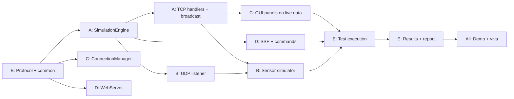

# AquaNet - Task Allocation (team of 4-5 students)

Fill in the names. If the team has 4 members, merge **Role E** into Roles A and D (as indicated in the table). Everybody must be able to answer viva questions about the whole system, so rotate "explain your part" sessions in week 6.

| Role | Student | Title |
|------|---------|-------|
| A | [TEAM TO FILL] | Server & simulation lead |
| B | [TEAM TO FILL] | Network protocol & UDP/sensors |
| C | [TEAM TO FILL] | GUI client developer |
| D | [TEAM TO FILL] | Web / SSE developer |
| E | [TEAM TO FILL] | QA, tools & documentation lead (4-member team: tests go to B, documentation split between C and D) |

## 1. Roles, deliverables and files owned

| Role | Main responsibilities | Deliverables | Files owned |
|------|----------------------|--------------|-------------|
| **A - Server & simulation** | Simulation model (tanks, pump, valves, demand, leak, AUTO rules), tick scheduler, thread-safety, alerts, TCP accept loop, client handlers, shutdown | Working server on port 5000; model constants table for the report; threading section of the report | `server/AquaNetServer.java`, `server/SimulationEngine.java`, `server/ClientHandler.java` |
| **B - Protocol, UDP & sensors** | Protocol specification and its stability, wire encoding, UDP receiver with loss statistics, sensor simulator (loss, fault modes), protocol self-test | Protocol chapter, UDP experiments (loss test results), `ProtocolSelfTest` passing | `common/*.java` (`Protocol`, `NetworkSnapshot`, `TankInfo`, `PumpInfo`, `ValveInfo`, `NetworkController`), `server/SensorUdpListener.java`, `sensor/SensorSimulator.java`, `test/ProtocolSelfTest.java` |
| **C - GUI client** | Swing client, connection manager (reader thread, reconnect, ping), tank/diagram/trend panels, controls, alerts and chat, EDT discipline | Working GUI client, screenshots, GUI chapter | `client/*.java` (`AquaNetClient`, `DashboardFrame`, `ConnectionManager`, `ClientListener`, `TankPanel`, `NetworkDiagramPanel`, `TrendChartPanel`, `ControlPanel`, `AlertChatPanel`, `Theme`) |
| **D - Web / SSE** | HTTP server, REST endpoints, SSE stream, static website pages, dashboard JavaScript, CSS | Website and dashboard, web chapter, SSE vs WebSocket explanation | `web/WebServer.java`, `web/*.html`, `web/css/style.css`, `web/js/*.js`, `web/favicon.svg` |
| **E - QA, tools & docs** | Console client, load-test client, test plan execution (TC01-TC25), result tables, scripts, user manual, developer guide, presentation, report assembly and proofreading | Test report with filled results, manual, guide, slides, final report PDF | `test/ConsoleClient.java`, `test/LoadTestClient.java`, `scripts/*`, `docs/*` |

Shared responsibilities: code review (each pull request or change reviewed by one other member), git/backups, the final demo, the viva preparation.

## 2. Interfaces between roles (agree these in week 1)

| Interface | Provider | Consumers | Frozen by |
|-----------|----------|-----------|-----------|
| Wire protocol (`Protocol.java` Javadoc) | B | A, C, D, E | End of week 1 |
| `NetworkController` interface | B (with A) | A, D, E | End of week 1 |
| Snapshot formats (`toWire`, `toJson`) | B | A, C, D | End of week 2 |
| Ports 5000 / 5001 / 8080 | B | all | Week 1 |
| JSON field names and REST routes | D (with A) | D's JavaScript, E's tests | Week 3 |

Any change to a frozen interface must be announced to the whole team and `ProtocolSelfTest` updated.

## 3. Week-by-week schedule (6 weeks)

| Week | A - Server | B - Protocol/UDP | C - GUI | D - Web | E - QA/Docs |
|------|-----------|------------------|---------|---------|-------------|
| **1** | Project set-up in Eclipse; simulation design on paper (equations, constants) | Write protocol spec and `common` classes; agree ports | Study Swing; paper mock-up of the window | Study HTTP/SSE; sketch the pages | Set up repository/backups, test plan skeleton, report outline |
| **2** | `SimulationEngine` physics, tick, `execute` | Wire/JSON encoding; `ProtocolSelfTest` | `ConnectionManager` with a fake/ConsoleClient server; `AquaNetClient` skeleton | `WebServer` static files + `/api/state` | `ConsoleClient`; first manual tests against the server |
| **3** | TCP accept loop, `ClientHandler`, broadcast, alerts, AUTO mode | `SensorUdpListener`; `SensorSimulator` basic | `TankPanel`, `ControlPanel`, connect to real server | `/events` SSE, `/api/command`, `dashboard.html` + JS | `LoadTestClient`; run TC01-TC14 |
| **4** | Thread-safety review, disconnect handling, shutdown, flags | Loss and fault modes; UDP statistics | `NetworkDiagramPanel`, `TrendChartPanel`, `AlertChatPanel`, reconnect | History/alerts endpoints, styling, remaining pages | Run TC15-TC25; log bugs; scripts |
| **5** | Fix bugs; performance with load test; model constants table | Packet-loss experiment, Wireshark captures | Polish, screenshots, edge cases (server restart) | Polish, browser tests, keep-alive/reconnect | Results chapter, user manual, developer guide; integration freeze (end of week) |
| **6** | Viva preparation; final regression | Viva preparation; final regression | Viva preparation | Viva preparation | Presentation, report proofreading, demo rehearsal x2, submission package |

## 4. Task dependencies

| Task | Depends on | Reason |
|------|-----------|--------|
| Protocol spec + `common` classes (B) | none | Everyone codes against it |
| Simulation engine (A) | `NetworkController` + snapshot classes (B) | Engine implements the interface and builds snapshots |
| TCP handlers (A) | Protocol spec, engine | Messages and command execution |
| GUI connection layer (C) | Protocol spec; `ConsoleClient` or a running server (A, E) | Needs something to talk to |
| GUI panels (C) | `NetworkSnapshot` (B) | Display data |
| SSE + REST (D) | `NetworkController` (B), JSON format (B), a running engine (A) | Serve the snapshot |
| UDP receiver (B) | Engine `updateSensor` method (A) | Store the measured value |
| Sensor simulator (B) | Server TCP `STATE` (A) and UDP listener (B) | Reads true levels, sends datagrams |
| Load test and test execution (E) | Server (A), tools | Needs working system |
| Report results chapter (E) | All test runs | Needs measurements |
| Presentation and demo (all) | Integration freeze (week 5) | Stable system |

Critical path: protocol spec -> engine -> TCP handlers -> GUI/web integration -> testing -> report -> demo.

## 5. Milestones and checkpoints

| End of week | Milestone | Check |
|-------------|-----------|-------|
| 1 | Protocol and interfaces frozen | Document reviewed by all |
| 2 | Engine ticking; console client can read STATE | `ProtocolSelfTest` passes |
| 3 | End-to-end: GUI + web show live data, commands work | TC01-TC14 pass |
| 4 | UDP sensors, loss/fault modes, disconnect handling | TC15-TC21 pass |
| 5 | Integration freeze; full test run; docs drafted | TC01-TC25 recorded |
| 6 | Report, slides and demo ready | Rehearsal done |

## 6. Working agreements

* Short weekly meeting (30 min) plus a quick status message every 2 days.
* Branch or folder per feature; merge only code that compiles and passes `ProtocolSelfTest`.
* Do not change another member's file without telling them; interface changes go through the whole team.
* Everyone writes the report section for their own module (as in the table) and reviews one other section.
* Contribution statement for the report: [TEAM TO FILL - one paragraph per student].

## 7. Individual marks evidence (optional, if the course asks)

| Student | Modules | Report sections | Tests run | Viva topics prepared |
|---------|---------|-----------------|-----------|----------------------|
| [TEAM TO FILL] | | | | |
